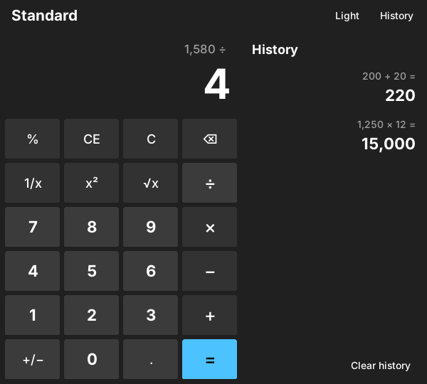
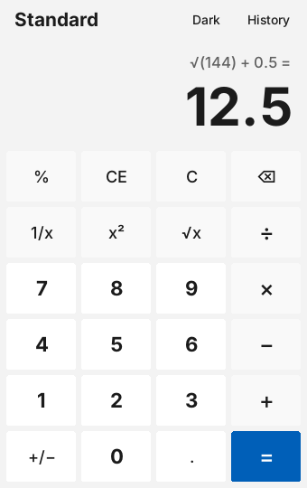

# Python Calculator

A desktop calculator written in **Python** with **Tkinter**, styled after the Windows 11 calculator.
It has clickable rounded buttons, keyboard support, a history panel, and a dark and a light theme.

It uses only the Python standard library, so there is nothing to install.



## Features

- Basic operations: `+ − × ÷`, plus `%`, `1/x`, `x²`, `√x`, `+/−`
- Works like the Windows calculator:
  - `2 + 3 × 4 =` gives **20** (each step is calculated immediately)
  - pressing `=` again repeats the last operation (`5 + 2 = = =` → 7, 9, 11)
  - `200 + 10 %` means 10 % of 200
- **Exact decimal maths**: `0.1 + 0.2` shows `0.3`, not `0.30000000000000004`
- Expression line above the result, e.g. `√(144) + 0.5 =`
- **History** panel: click an entry to use its result again
- **Dark and light theme**
- Full **keyboard support**
- Clear error messages: *Cannot divide by zero*, *Invalid input*
- Long numbers shrink to fit the window; very large ones switch to scientific notation
- 30 unit tests for the calculation logic



## Run it

Requires Python 3.10 or newer (Tkinter is included in the standard Windows and macOS installers).

```bash
git clone https://github.com/dwislocki80-hub/python-calculator.git
cd python-calculator
python -m calculator
```

On Linux you may need to install Tkinter first: `sudo apt install python3-tk`.

## Keyboard shortcuts

| Key                | Action          |
|--------------------|-----------------|
| `0`–`9`, `.` `,`   | type a number   |
| `+` `-` `*` `/`    | operators       |
| `Enter` or `=`     | equals          |
| `Backspace`        | delete a digit  |
| `Esc`              | C (clear all)   |
| `Delete`           | CE (clear entry)|
| `%`                | percent         |
| `@` / `q` / `r`    | √x / x² / 1/x   |
| `F9`               | +/−             |
| `Ctrl+H`           | show/hide history |

## How it works

The project is split into **logic** and **interface**:

```
calculator/
├── engine.py    # all the maths – no Tkinter at all
├── gui.py       # the window: layout, themes, keyboard, history panel
├── widgets.py   # RoundedButton – a flat, rounded button drawn on a Canvas
└── __main__.py  # starts the app:  python -m calculator
tests/
└── test_engine.py
```

**`engine.py`**: the `Calculator` class keeps the state (the number on screen, the number
waiting for the second operand, the pending operator) and exposes one method per button,
such as `press_digit()`, `press_operator()` and `press_equals()`. After every action the GUI
reads two properties: `display` (the big number) and `expression` (the line above it).
Because the engine does not know anything about windows, it can be tested with plain
`unittest`, without opening the app.

**Decimal instead of float**: numbers are stored as `decimal.Decimal`. A `float` cannot
represent 0.1 exactly, which is why `0.1 + 0.2` gives `0.30000000000000004` in most languages.
`Decimal` keeps exact decimal digits, so the calculator shows what a person expects.

**`widgets.py`**: the standard `tk.Button` cannot have rounded corners, and on some systems
it ignores background colours. `RoundedButton` is a small `Canvas` that draws a rounded
rectangle and the label, and changes colour on hover and press. It runs its command only
if the mouse is released over the button, like a native button.

**`gui.py`**: builds the 6 × 4 keypad from a `LAYOUT` table, where each entry names the
engine method that button calls. Keyboard keys are mapped to the same buttons, so a key press
also flashes the button on screen. Colours come from a `THEMES` dictionary, which makes
switching between dark and light a matter of re-colouring every widget.

## Running tests

```bash
python -m unittest -v
```

## Possible next steps

- Scientific mode (sin, cos, log, powers)
- Memory buttons (MC, MR, M+, M−)
- Package as a Windows `.exe` with PyInstaller

## License

MIT
